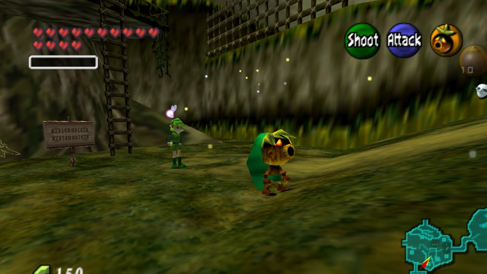
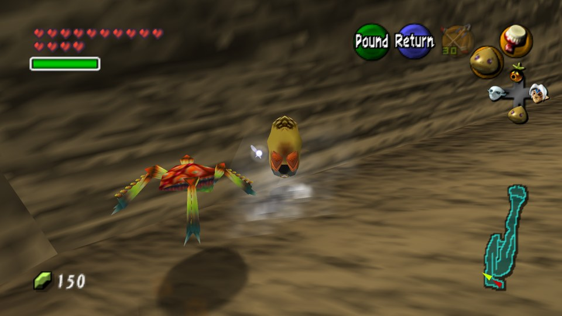
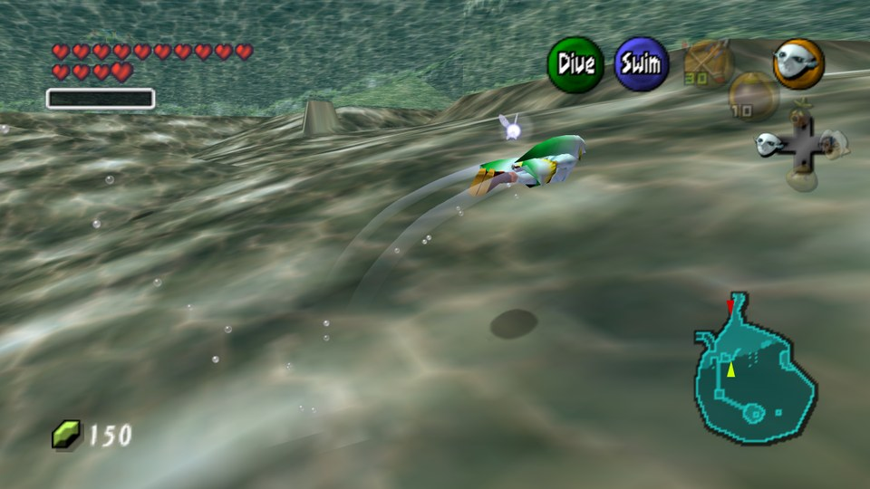
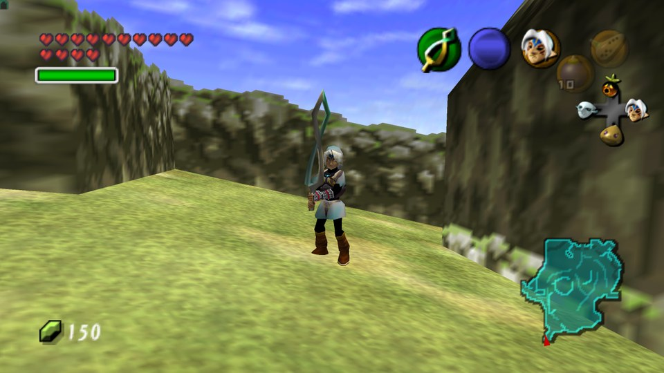
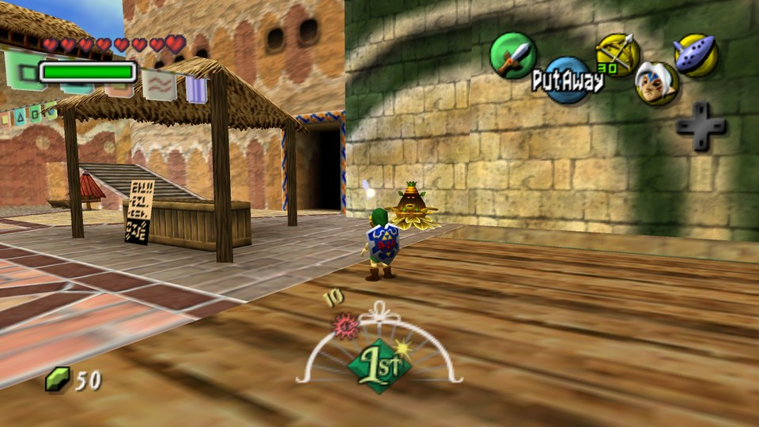
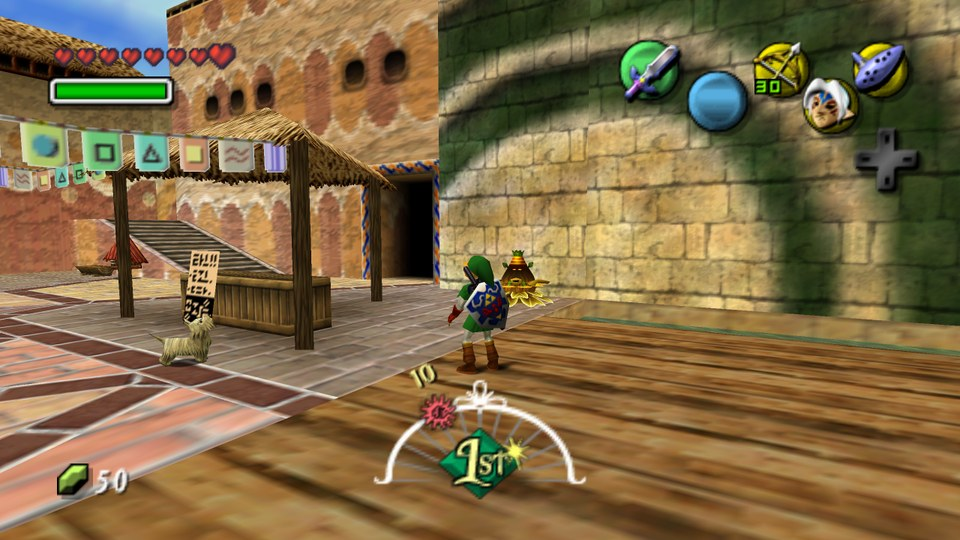
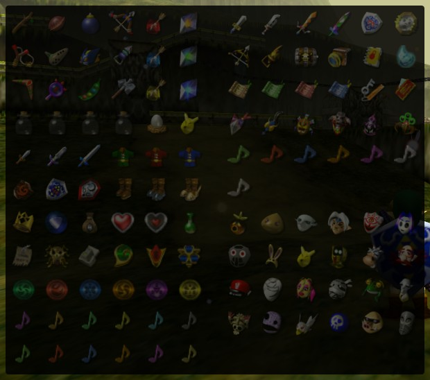
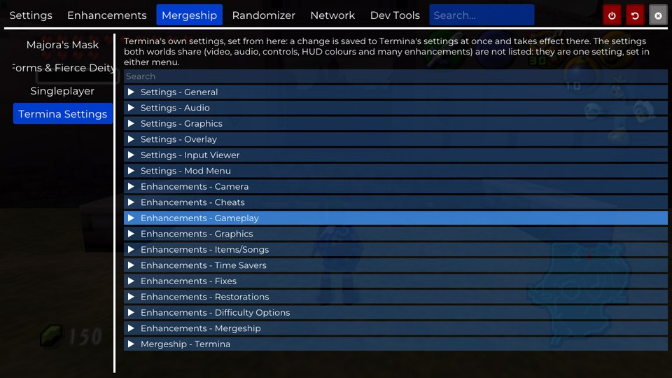
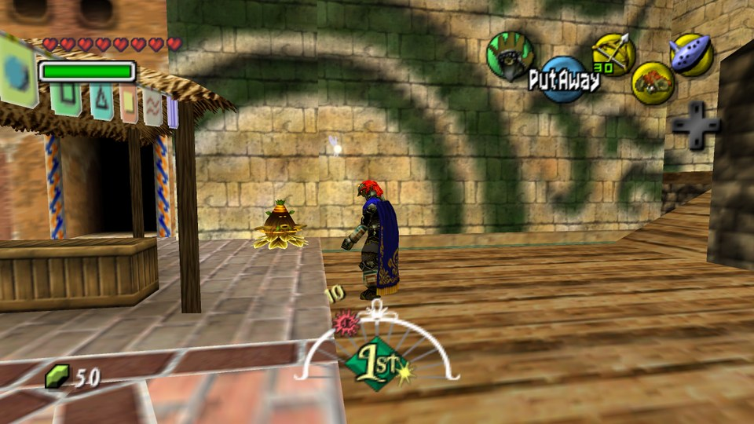

# MergeShip

Ocarina of Time and Majora's Mask as one game on PC. One program, `mergeship.exe`, runs both
[Ship of Harkinian](https://github.com/HarbourMasters/Shipwright) (Hyrule) and
[2 Ship 2 Harkinian](https://github.com/HarbourMasters/2ship2harkinian) (Termina). It switches between them through a
door in the Lost Woods, with one shared save: hearts, magic, rupees, items, masks and quest status.

What it adds on top of the two ports:

- **All four of Majora's Mask's transformations in Ocarina of Time.** The Deku, Goron, Zora and Fierce Deity masks,
  with their own moves, cutscenes, sounds and items.
- **Ocarina of Time's adult Link in Termina.** He brings Hyrule's swords, shields, items and equipment.
- **A unified randomizer** across both worlds, with Anchor multiplayer.
- **Quality-of-life features.** Sprinting, a shared item tracker, and one settings menu that reaches both games.

Every MergeShip feature is optional, from the **Mergeship** menu in either game.

## Screenshots

<table>
<tr>
<td width="50%"><br><b>Deku Link</b> in Kokiri Forest. Majora's Mask's masks work in Ocarina of Time.</td>
<td width="50%"><br><b>Goron Link</b> rolling up Death Mountain Trail, past a Tektite.</td>
</tr>
<tr>
<td><br><b>Zora Link</b> swimming through Lake Hylia.</td>
<td><br><b>The Fierce Deity</b> in Hyrule Field.</td>
</tr>
<tr>
<td><br><b>Into Termina</b> through the Lost Woods, with Hyrule's Hylian Shield on his back.</td>
<td><br><b>Adult Link in Termina</b>, with the Master Sword and the Hylian Shield.</td>
</tr>
<tr>
<td><br><b>One item tracker</b> for both worlds: Hyrule's items on the left, Termina's on the right.</td>
<td><br><b>One settings menu</b>: Termina's settings, opened from Ocarina of Time's menu.</td>
</tr>
<tr>
<td><br><b>A secret Ganondorf mode</b>, here in Clock Town.</td>
<td></td>
</tr>
</table>

**No game data is included.** You need your own Ocarina of Time and Majora's Mask ROMs. On its first run the game
builds `oot.o2r` and `mm.o2r` from them.

Player builds: https://odysseyapp.fun/mergeship-dist-latest.zip

## Layout

| Folder | What it is |
|---|---|
| `host/` | `mergeship.exe`: loads both engines (`soh.dll`, `2ship.dll`) and hands the window, audio, controllers and the shared save between them |
| `include/mergeship/` | Code both engines share: the engine API, the shared save, the settings map, sprinting, the menu mirror and more |
| `Shipwright/` | The Ship of Harkinian fork (its `mergeship2` branch), with its `libultraship` and `torch` |
| `2ship2harkinian/` | The 2 Ship 2 Harkinian fork (its `mergeship2` branch), with its `libultraship`, `ZAPDTR` and `OTRExporter` |
| `tools/` | Build, test and asset scripts (`build_host.ps1`, `run_final.sh`, the settings-map checker, and more) |
| `assets/` | MergeShip's own assets |
| `android/` | The Android build |
| `docs/` | Architecture, status and design notes |

The submodules are included as plain folders, MergeShip's changes and all. Both engines are built against the same
libultraship.

## Building (Windows)

You need Visual Studio 2022 with C++, CMake and Python 3. The build sets up its own vcpkg.

```powershell
powershell -ExecutionPolicy Bypass -File tools\build_host.ps1          # configure + build everything, then stage
powershell -ExecutionPolicy Bypass -File tools\build_host.ps1 -Fast    # after a code change
```

The game is staged into `build\latest`. Run `mergeship.exe` from there and point it at your ROMs on its first run.

Keep line endings as they are (`git config core.autocrlf false`): libultraship's dependency patches need LF.

## Credits and licenses

MergeShip contributors:

- [Vio (@AgitationSkeleton)](https://github.com/AgitationSkeleton): the transformation forms and Fierce Deity features
  from soh_fd, including the Fierce Deity's sword beam, and most of the bug reports and testing.

Ship of Harkinian and 2 Ship 2 Harkinian are by [HarbourMasters](https://github.com/HarbourMasters) and their
contributors. Each port, and each library under them, keeps its own license file in its folder. MergeShip is built on
their work.
